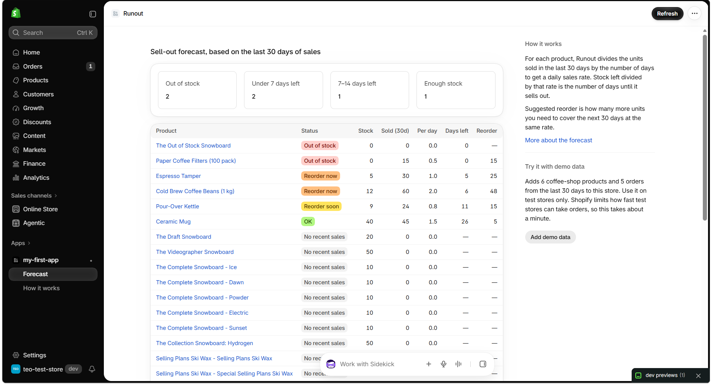

# Runout

**A Shopify app that tells store owners how many days until each product sells out.**

Most low-stock alerts warn you when a product drops below a fixed number, like 5 units. But 5 units of something that sells 10 a day is an emergency, and 5 units of something that sells once a month is fine. Runout looks at how fast each product has actually sold over the last 30 days and ranks products by how soon they'll run out, so owners know what to reorder first.



## What it does

- Shows every tracked product with its stock, recent sales, daily sales rate and **days until it sells out**.
- Sorts the list so the most urgent products are at the top.
- Labels each product: **Out of stock**, **Reorder now** (under 7 days), **Reorder soon** (7–14 days), **OK**, **No recent sales**, or **Not tracked** (Shopify doesn't count its stock, or it's a gift card, which can't sell out).
- Suggests how many units to reorder to cover the next 30 days.
- Includes an **Add demo data** button that fills a test store with 6 products and 5 backdated orders, so you can see it working straight away. Test stores only accept about one order every 12 seconds, so it paces the orders and can safely be clicked again to finish if Shopify refuses one.

## How the forecast works

```
daily sales rate  = units sold in the last 30 days ÷ 30
days left         = units in stock ÷ daily sales rate
suggested reorder = (daily sales rate × 30) − units in stock
```

Example: 12 bags of coffee in stock, 60 sold in the last 30 days, so 2 a day. The stock lasts about 6 days, which means **Reorder now**.

Cancelled orders and refunded units aren't counted. Products that sold nothing recently show "No recent sales", because there's no rate to forecast from.

## How it's built

| Part | What it does |
|---|---|
| [`app/runout/forecast.js`](app/runout/forecast.js) | The forecast maths. Plain JavaScript with no Shopify code, so it's easy to test. |
| [`app/runout/forecast.test.js`](app/runout/forecast.test.js) | 14 automated tests for the maths, including the edge cases between statuses (exactly 7 days left, oversold stock, no sales, untracked products). |
| [`app/runout/shopify-data.server.js`](app/runout/shopify-data.server.js) | Fetches product variants, stock levels and the last 30 days of orders from the Shopify Admin GraphQL API, page by page. |
| [`app/runout/demo-data.server.js`](app/runout/demo-data.server.js) | Creates the demo products (`productSet`) and backdated orders (`orderCreate`). |
| [`app/routes/app._index.jsx`](app/routes/app._index.jsx) | The forecast page inside the Shopify admin, built with Polaris web components. |
| [`app/routes/app.how-it-works.jsx`](app/routes/app.how-it-works.jsx) | A page explaining the calculation to store owners. |

**Tech:** Shopify app template (React Router, JavaScript), Shopify Admin GraphQL API (version 2026-07), Polaris web components, App Bridge.

**Permissions:** reads products, inventory and orders. The write permissions are only used by the "Add demo data" button.

## Run it yourself

You need [Node.js](https://nodejs.org), the [Shopify CLI](https://shopify.dev/docs/apps/tools/cli) and a free [Shopify development store](https://shopify.dev/docs/apps/tools/development-stores).

```shell
npm install
shopify app dev
```

Open the app in your store (the preview link is under **(d) Dev status**), then click **Add demo data**.

To run the tests:

```shell
npm test
```

## Limits and what I'd do next

- **It assumes the future looks like the past 30 days.** Seasonal products, sales and new launches will be off. Next step: weight recent days more heavily, or compare against the same period last year.
- **Stock is totalled across all locations.** Next step: forecast per warehouse.
- **It reads up to 1,000 recent orders.** That's fine for small stores. A large store would need Shopify's [bulk operations](https://shopify.dev/docs/api/usage/bulk-operations/queries).
- **It doesn't send alerts.** Next step: a daily email listing the "Reorder now" products.

## How I built it

I built Runout with [Claude Code](https://claude.com/claude-code) as an AI pair programmer, starting from Shopify's official app template. <!-- Add a sentence or two in your own words: what you learned, what was hardest, what you'd change. -->
